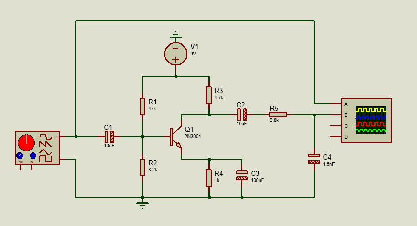
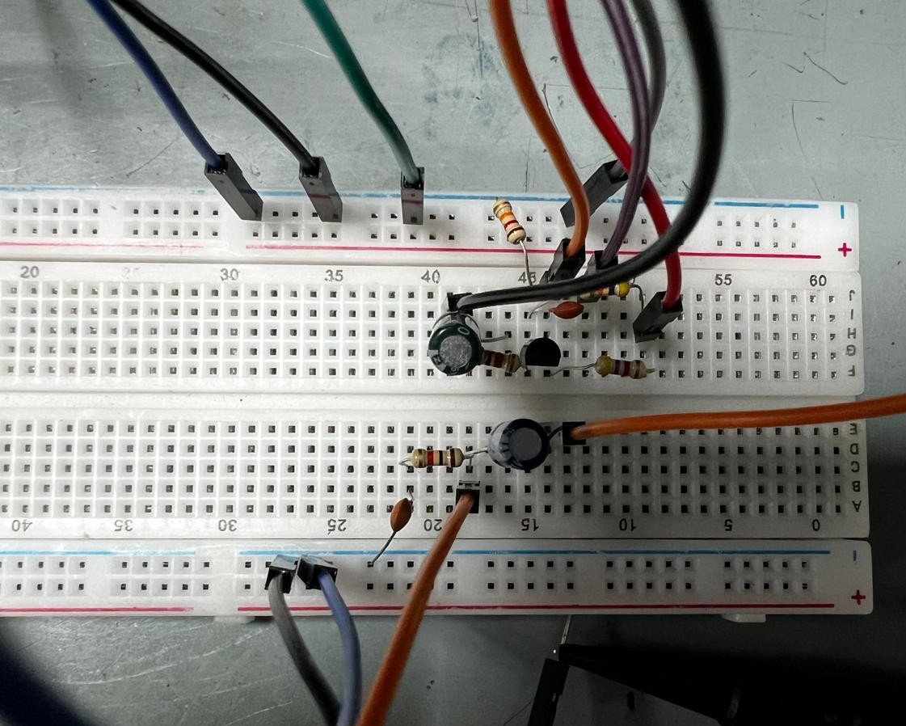
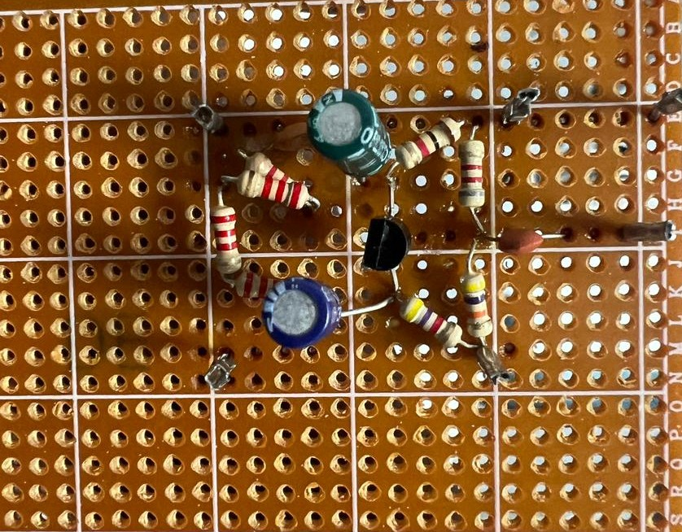
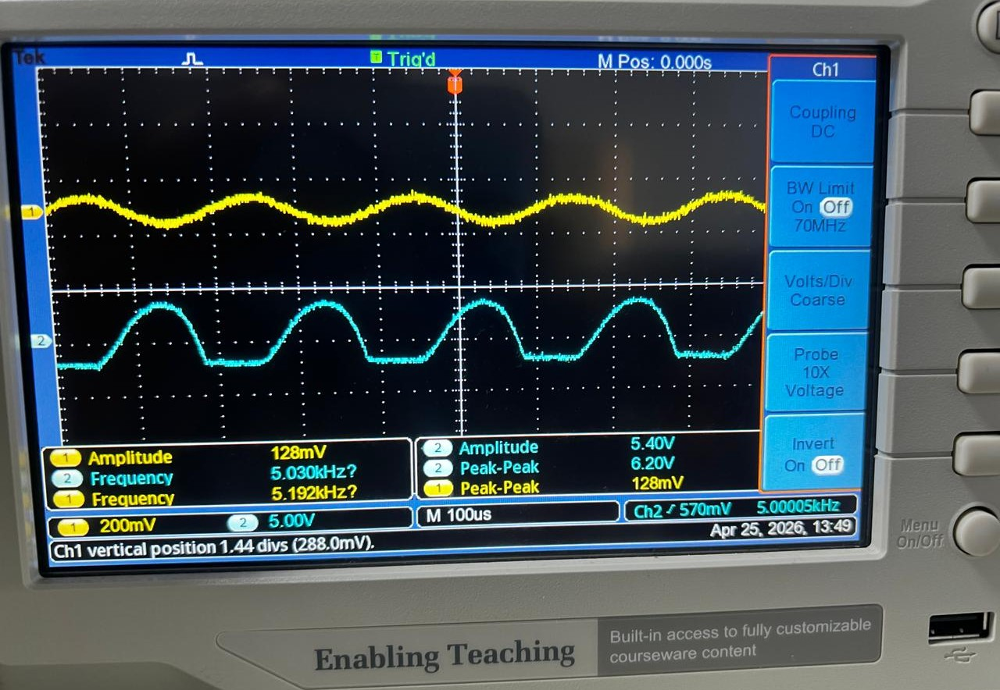

# BJT and RC Analog Signal Conditioning for AM Audio

This IE2034 Analog Electronics project uses a **9 V common-emitter BJT amplifier** and two first-order RC networks to condition recovered audio for a basic AM radio. The circuit was simulated in **Proteus**, prototyped on a breadboard, and soldered onto a **Dot Board**.

[Final report](docs/analog-electronics-final-report.pdf) · [Proteus waveforms](simulation/proteus-waveforms.png) · [5 kHz oscilloscope capture](measurements/oscilloscope-5khz.jpg)

## Circuit design and assignment targets

| Signal stage | Assignment target | Circuit implementation |
| --- | --- | --- |
| 1. RC high-pass filter | 2 kHz lower cutoff | C1 (10 nF) couples the input into the base bias network. It blocks DC and attenuates low-frequency signals. R2 (8.2 kΩ) is used for the nominal cutoff calculation. |
| 2. Common-emitter BJT amplifier | Midband voltage gain of at least 60 V/V, with active-region bias from a 9 V DC supply | R1 (47 kΩ) and R2 set the base bias. R3 (4.7 kΩ) is the collector load. R4 (1 kΩ) provides DC emitter feedback, and C3 (100 µF) bypasses R4 for AC to increase gain. |
| 3. RC low-pass filter | 12 kHz upper cutoff | C2 (10 µF) blocks the collector DC level. R5 (8.8 kΩ) and C4 (1.5 nF) form the output low-pass network and attenuate high-frequency signals. |

The input coupling network provides the high-pass function at the amplifier input. Together, the two RC networks target a **2–12 kHz band-pass response**. Component values follow the Proteus schematic, which labels Q1 as **2N3904**. The final report's amplifier description lists **2N2222**.

### Cutoff, bias, and gain calculations

| Quantity | First-pass calculation | Estimate |
| --- | --- | --- |
| Lower RC cutoff | 1 ÷ (2π × 8.2 kΩ × 10 nF) | 1.94 kHz |
| Upper RC cutoff | 1 ÷ (2π × 8.8 kΩ × 1.5 nF) | 12.06 kHz |
| DC operating point | VB ≈ 9 V × 8.2 ÷ (47 + 8.2). With VBE ≈ 0.70 V, IE ≈ (VB − 0.70 V) ÷ 1 kΩ. | VB ≈ 1.34 V, VE ≈ 0.64 V, IE ≈ 0.64 mA |
| Collector bias | VC ≈ 9 V − IE × 4.7 kΩ. VCE ≈ VC − V_E. | VC ≈ 6.0 V, VCE ≈ 5.37 V |
| Unloaded collector-stage gain | rₑ ≈ 25 mV ÷ IE ≈ 39 Ω. With the emitter AC-bypassed, Av ≈ −4.7 kΩ ÷ rₑ. | About −120 V/V from base to collector |

The cutoff calculations use ideal RC pairs. Source impedance, amplifier input impedance, and output loading shift the actual cutoffs. The bias estimate neglects base current, and the gain estimate assumes a small signal and an unloaded collector stage. The negative gain denotes phase inversion at the collector. The 60 V/V target requires an unclipped measurement under the actual circuit loading.

## Prototype builds

| Breadboard | Dot Board |
| --- | --- |
|  |  |

## Simulation and bench results

The [Proteus capture](simulation/proteus-waveforms.png) shows the circuit input and output with the generator set to about **10.1 kHz** and **101 mV peak-to-peak**.

| 5 kHz bench test | Reading |
| --- | --- |
| Function generator setting | 100 mV peak-to-peak, sine wave, 0 V DC offset |
| Oscilloscope input (CH1) | 128 mV peak-to-peak |
| Oscilloscope output (CH2) | 6.20 V peak-to-peak |
| Output-to-input ratio using both oscilloscope readings | 6.20 V ÷ 0.128 V ≈ **48.4 V/V** |

Using the [generator setting](measurements/function-generator-5khz.jpg) as the denominator gives **62 V/V**, the ratio quoted in the report. The output visibly clips, so both ratios describe a large-signal capture. Pages 9–10 of the [final report](docs/analog-electronics-final-report.pdf) also show bench captures at 10 kHz and 25 kHz.

### Stage-by-stage verification

The available captures document the overall input and output. To verify each stage, the assignment calls for oscilloscope traces before and after each filter and after the amplifier. The corresponding probe points are the generator output, the base after C1, the collector, the node between C2 and R5, and the output across C4.

An unclipped frequency sweep would locate the lower and upper −3 dB points. Recording both base-to-collector gain and overall input-to-output gain would separate amplifier performance from filter and loading effects. DC readings at the base, emitter, and collector would verify the estimated operating point on the Dot Board.
